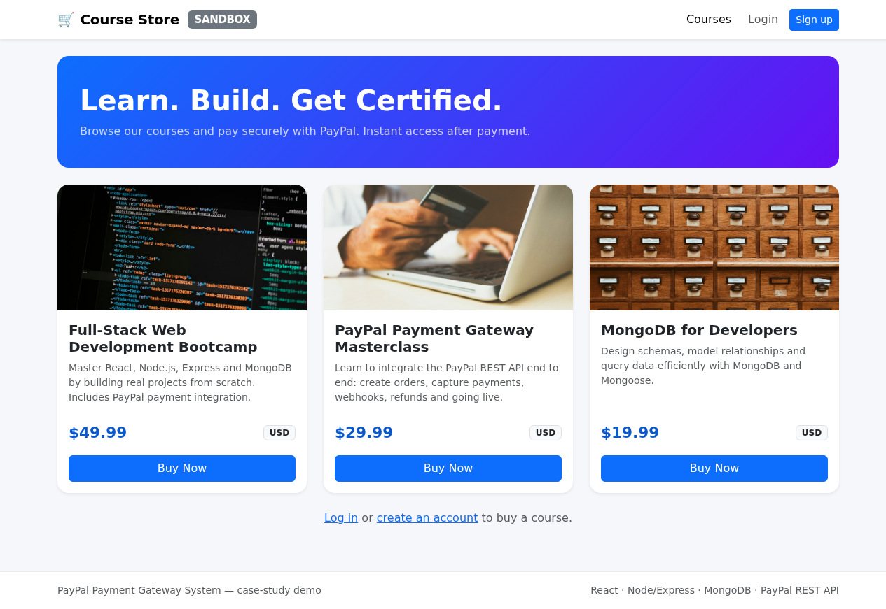
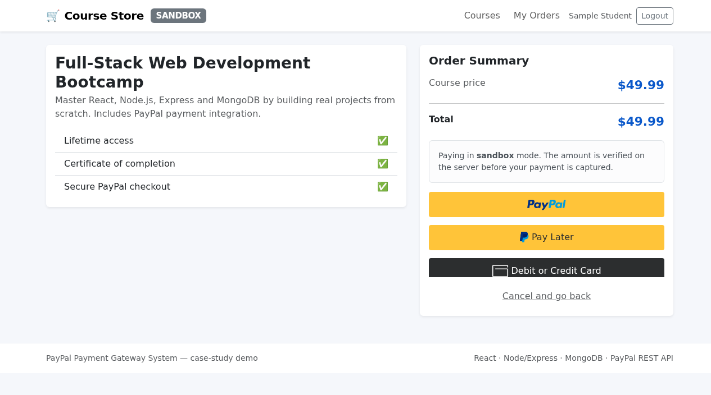
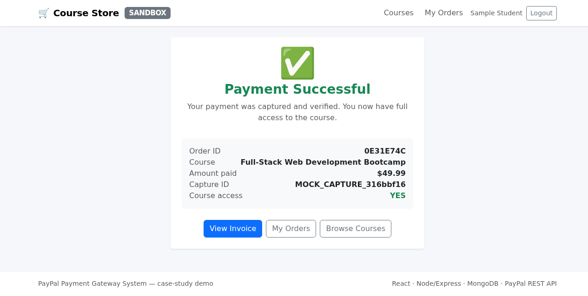
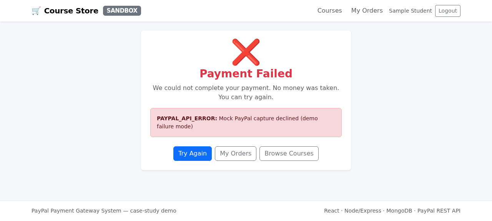
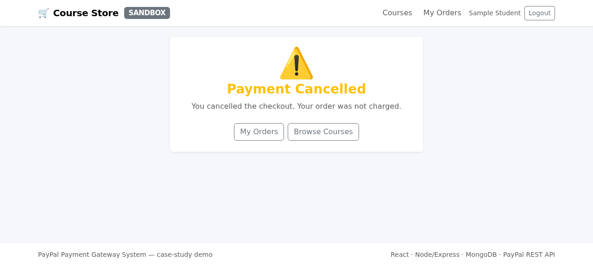
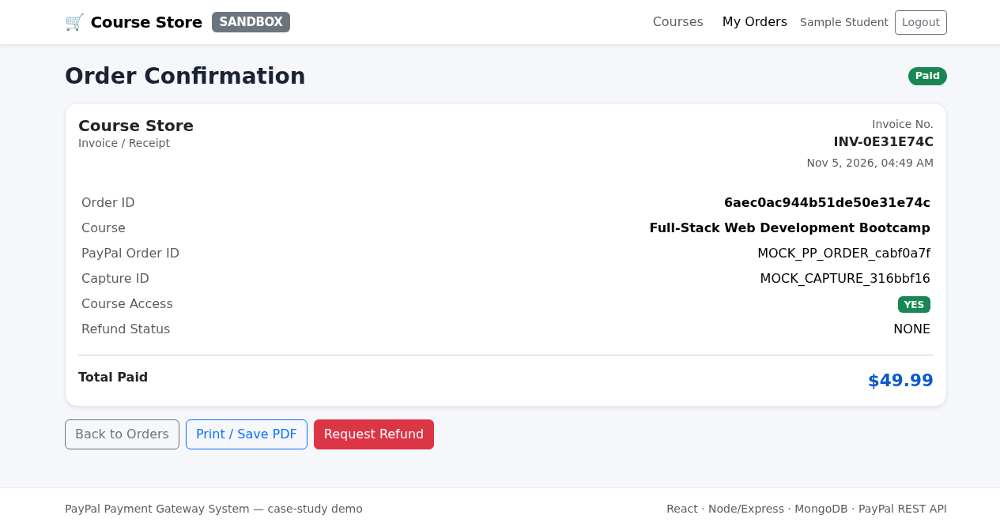
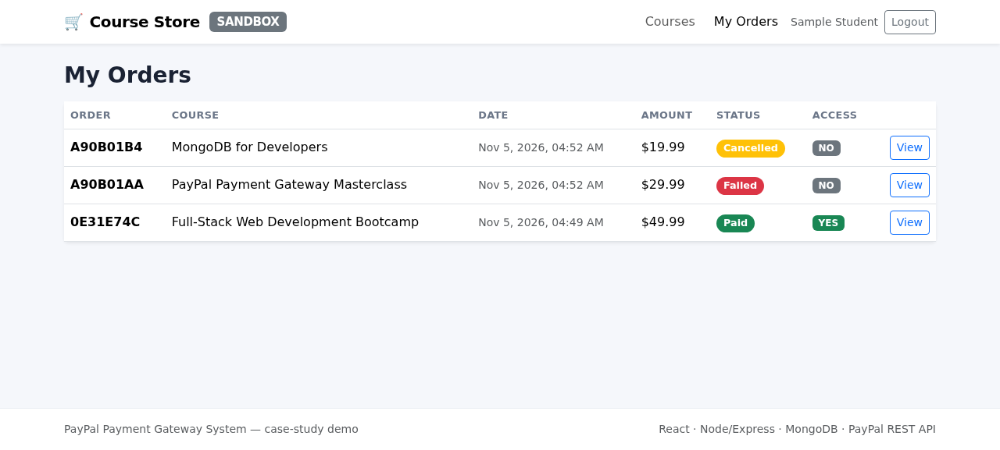
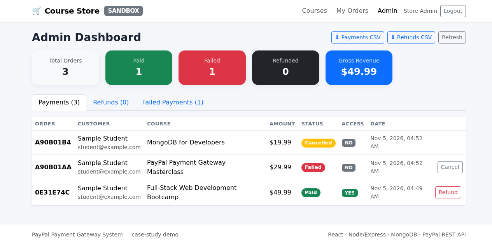
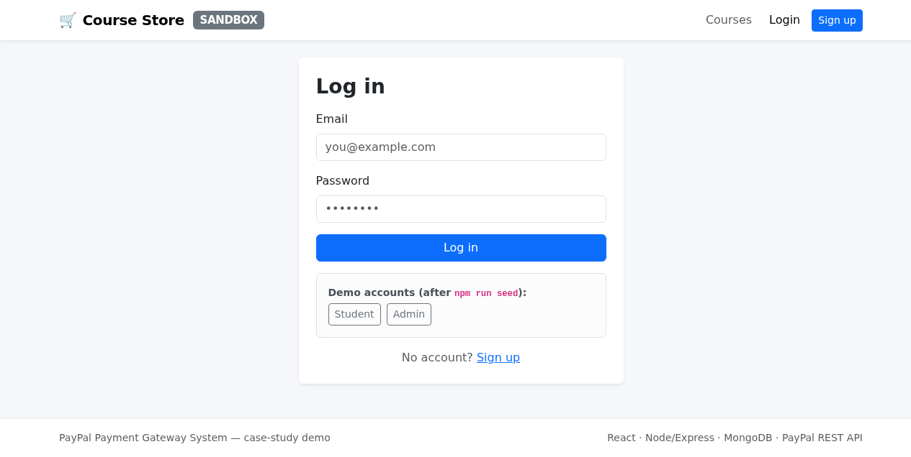

# PayPal Payment Gateway System

A complete, ready-to-run **course store** with a full **PayPal payment gateway** integration.

- **Frontend:** React 18 + Vite + Bootstrap 5 + `@paypal/react-paypal-js`
- **Backend:** Node.js + Express (ES modules) + Mongoose
- **Database:** MongoDB
- **Payments:** PayPal REST API v2 (Orders + Payments), OAuth 2.0, webhooks, refunds

> This is a case-study submission. It ships with sample data so you can demonstrate a
> full sandbox payment end to end within minutes of adding your own credentials.

---

## Table of contents

1. [What you get](#1-what-you-get)
2. [Folder structure](#2-folder-structure)
3. [Prerequisites](#3-prerequisites)
4. [Quick start (5 steps)](#4-quick-start-5-steps)
5. [Configure your credentials](#5-configure-your-credentials)
6. [MongoDB setup](#6-mongodb-setup)
7. [PayPal Developer / Sandbox setup](#7-paypal-developer--sandbox-setup)
8. [Where the receiving account is configured](#8-where-the-receiving-account-is-configured)
9. [Running the app](#9-running-the-app)
10. [Test a sandbox payment end to end](#10-test-a-sandbox-payment-end-to-end)
11. [Webhooks](#11-webhooks)
12. [Switching from sandbox to live](#12-switching-from-sandbox-to-live)
13. [API reference](#13-api-reference)
14. [Troubleshooting](#14-troubleshooting)

---

## 1. What you get

| Feature | Where |
|---|---|
| Course/product listing with **Buy Now** | `frontend/src/pages/CourseListPage.jsx` |
| PayPal JS SDK checkout (`onApprove` → capture) | `frontend/src/pages/CheckoutPage.jsx` |
| Success / failure / cancel UI states | `frontend/src/pages/PaymentResultPage.jsx` |
| Order confirmation + invoice + refund request | `frontend/src/pages/OrderConfirmationPage.jsx` |
| Order history | `frontend/src/pages/OrderHistoryPage.jsx` |
| Admin dashboard (payments, refunds, reports, cancel, failed) | `frontend/src/pages/AdminDashboardPage.jsx` |
| `POST /create-order` (server-side price) | `backend/src/controllers/paymentController.js` |
| `POST /capture-order` (server-side verification) | `backend/src/controllers/paymentController.js` |
| Webhook `PAYMENT.CAPTURE.COMPLETED` + signature check | `backend/src/controllers/webhookController.js` |
| PayPal OAuth 2.0 + API calls | `backend/src/services/paypalService.js` |
| Models: User, Course, Order, WebhookEvent | `backend/src/models/` |
| Seed data (sample user + courses) | `backend/scripts/seed.js` |

---

## 2. Folder structure

```
paypal-payment-gateway/
├── package.json                 # root: runs backend + frontend together
├── README.md                    # this file
├── CASE_STUDY_MAPPING.md        # code → case-study sections
├── .gitignore
│
├── backend/
│   ├── package.json
│   ├── .env.example             # ← copy to .env and fill in YOUR values
│   ├── scripts/
│   │   └── seed.js              # sample user + courses
│   └── src/
│       ├── server.js            # entry point (starts HTTP server)
│       ├── app.js               # express app, middleware, routes
│       ├── config/
│       │   ├── env.js           # loads + validates .env
│       │   ├── db.js            # MongoDB connection
│       │   └── paypal.js        # PayPal config (sandbox/live)
│       ├── models/
│       │   ├── User.js          # _id, name, email
│       │   ├── Course.js        # price lives here (source of truth)
│       │   ├── Order.js         # paypalOrderId, captureId, paymentStatus, courseAccess
│       │   └── WebhookEvent.js  # webhook idempotency
│       ├── services/
│       │   ├── paypalService.js # OAuth token, create/capture/refund, verify webhook
│       │   └── orderService.js  # order business rules
│       ├── controllers/
│       │   ├── authController.js
│       │   ├── courseController.js
│       │   ├── paymentController.js   # create-order, capture-order, cancel, refund
│       │   ├── webhookController.js   # PAYMENT.CAPTURE.COMPLETED
│       │   ├── orderController.js
│       │   └── adminController.js     # payments, refunds, reports, cancel, failed
│       ├── routes/              # one router per resource
│       ├── middleware/          # auth, validation, error handler, rate limit
│       └── utils/               # logger, AppError, jwt, asyncHandler
│
└── frontend/
    ├── package.json
    ├── vite.config.js           # dev proxy /api → localhost:5000
    ├── index.html
    ├── .env.example
    └── src/
        ├── main.jsx
        ├── App.jsx              # routes + PayPalScriptProvider
        ├── styles.css
        ├── api/client.js        # axios client + typed endpoints
        ├── context/             # AuthContext, ConfigContext
        ├── components/          # NavBar, Footer, StatusBadge, ErrorAlert
        ├── pages/               # all screens
        └── utils/format.js
```

---

## 3. Prerequisites

| Tool | Version | Notes |
|---|---|---|
| Node.js | **18 or newer** | `node -v` |
| npm | 9+ | ships with Node |
| MongoDB | 6+ | local install **or** a free MongoDB Atlas cluster |
| PayPal account | — | free; a Developer (sandbox) account is enough to start |

---

## 4. Quick start (5 steps)

```bash
# 1. Install everything (root + backend + frontend)
npm run install:all

# 2. Create your backend env file
cp backend/.env.example backend/.env
#    → open backend/.env and paste your PayPal Client ID / Secret + MongoDB URI

# 3. Load sample data (sample user + 3 courses)
npm run seed

# 4. Start backend + frontend together
npm run dev
```

Then open **http://localhost:5173**.

> **Ports:** frontend `5173`, backend `5000`.
> `npm run dev` starts **both together** (via `concurrently`).
> To run them separately: `npm run dev:backend` and `npm run dev:frontend`.

**Demo logins** (created by `npm run seed`):

| Role | Email | Password |
|---|---|---|
| Student | `student@example.com` | `password123` |
| Admin | `admin@example.com` | `admin123` |

---

## 5. Configure your credentials

**Everything you must supply lives in ONE file: `backend/.env`.**

```bash
cp backend/.env.example backend/.env
```

Open `backend/.env` and set these values:

| Variable | What to put | Where to get it |
|---|---|---|
| `MONGODB_URI` | your MongoDB connection string | [§6](#6-mongodb-setup) |
| `PAYPAL_CLIENT_ID` | your PayPal app Client ID | [§7](#7-paypal-developer--sandbox-setup) |
| `PAYPAL_CLIENT_SECRET` | your PayPal app Secret | [§7](#7-paypal-developer--sandbox-setup) |
| `PAYPAL_WEBHOOK_ID` | your webhook id | [§11](#11-webhooks) |
| `PAYPAL_MODE` | `sandbox` or `live` | [§12](#12-switching-from-sandbox-to-live) |
| `PAYPAL_RECEIVING_ACCOUNT` | the account that receives money | [§8](#8-where-the-receiving-account-is-configured) |
| `JWT_SECRET` | any long random string | `openssl rand -hex 32` |

> ⚠️ **Never commit `backend/.env`.** It is already in `.gitignore`.
> The **Client Secret is used only on the backend** and is never sent to the browser.

The frontend needs **no secrets**. It fetches the public Client ID from
`GET /api/config` at runtime.

---

## 6. MongoDB setup

Pick **one** option.

### Option A — Local MongoDB (simplest)

1. Install MongoDB Community Server: <https://www.mongodb.com/try/download/community>
2. Start it:
   - macOS (Homebrew): `brew services start mongodb-community`
   - Linux (systemd): `sudo systemctl start mongod`
   - Windows: it runs as a service after install
3. In `backend/.env`:
   ```
   MONGODB_URI=mongodb://127.0.0.1:27017/paypal_gateway
   ```

### Option B — MongoDB Atlas (free cloud cluster)

1. Create a free account at <https://www.mongodb.com/cloud/atlas/register>
2. Create a **free M0 cluster**.
3. **Database Access** → add a user (username + password).
4. **Network Access** → add your IP (or `0.0.0.0/0` for testing).
5. **Connect → Drivers** → copy the connection string and set it in `backend/.env`:
   ```
   MONGODB_URI=mongodb+srv://<user>:<password>@<cluster>.mongodb.net/paypal_gateway
   ```
   Replace `<user>`, `<password>`, `<cluster>` with your values.

> The database and collections are created automatically on first write.
> Run `npm run seed` to populate sample data.

---

## 7. PayPal Developer / Sandbox setup

You need a **Business** sandbox account (receives money) and a **Personal** sandbox
account (pays). PayPal creates both for you automatically.

### 7.1 Create the app and get credentials

1. Go to <https://developer.paypal.com/dashboard/> and log in (a normal PayPal
   account works; it becomes your Developer account).
2. Open **Apps & Credentials**.
3. Make sure the **Sandbox** tab is selected.
4. Click **Create App**, give it a name (e.g. `Course Store`), choose the
   **Merchant** app type, and create it.
5. Copy the **Client ID** and **Secret** and paste them into `backend/.env`:
   ```
   PAYPAL_MODE=sandbox
   PAYPAL_CLIENT_ID=AXxxxxxxxxxxxxxxxxxxxxxxxxxxxxxxxxxxxxxxxxxxxxxxxx
   PAYPAL_CLIENT_SECRET=ELxxxxxxxxxxxxxxxxxxxxxxxxxxxxxxxxxxxxxxxxxxxx
   ```

### 7.2 Get your sandbox test accounts

1. In the Developer Dashboard go to **Testing Tools → Sandbox Accounts**.
2. You will see two accounts created by default:
   - a **Business** account (e.g. `sb-xxxx@business.example.com`) — the **seller/receiver**
   - a **Personal** account (e.g. `sb-yyyy@personal.example.com`) — the **buyer**
3. Click **⋯ → View/Edit account** on the Personal account to see its **email** and
   set/reset its **password**. You will use these to log in during checkout.

### 7.3 Point the app at your Business sandbox account

In `backend/.env`:
```
PAYPAL_RECEIVING_ACCOUNT=sb-xxxx@business.example.com
```
(Use the Business sandbox account email from step 7.2. See §8 for why.)

---

## 8. Where the receiving account is configured

The **receiving account** (the PayPal account that gets the money) is configured in
**one place**:

```
backend/.env  →  PAYPAL_RECEIVING_ACCOUNT
```

| Mode | Value to use |
|---|---|
| **Sandbox** | your **Business sandbox** account email, e.g. `sb-xxxx@business.example.com` |
| **Live** | **`chandraniyash11-1@oksbi`** |

**How the money actually reaches that account:** PayPal routes funds to the account
that owns the **Client ID / Secret** used to create the order. So:

- In **sandbox**, the money goes to the Business sandbox account tied to your sandbox
  app credentials.
- In **live**, the money goes to the account that owns your **live** app credentials.
  To make live payments land in **`chandraniyash11-1@oksbi`**, you must:
  1. Log in to PayPal **as `chandraniyash11-1@oksbi`**,
  2. create a **Live** app under **Apps & Credentials → Live**,
  3. copy that app's **Live Client ID / Secret** into `backend/.env`,
  4. set `PAYPAL_MODE=live` and `PAYPAL_RECEIVING_ACCOUNT=chandraniyash11-1@oksbi`.

`PAYPAL_RECEIVING_ACCOUNT` is also surfaced by `GET /api/health` and shown in the
backend startup log, so you can always confirm which account is configured.

---

## 9. Running the app

### Everything at once (recommended)

```bash
npm run dev
```

| Service | URL | Port |
|---|---|---|
| Frontend (Vite) | http://localhost:5173 | 5173 |
| Backend (Express) | http://localhost:5000 | 5000 |
| Health check | http://localhost:5000/api/health | 5000 |

`npm run dev` uses `concurrently` to start **both** processes in one terminal.
The Vite dev server proxies `/api/*` to the backend, so there are no CORS issues.

### Separately (two terminals)

```bash
# terminal 1
npm run dev:backend     # nodemon, auto-restarts on change

# terminal 2
npm run dev:frontend    # vite
```

### Other commands

| Command | What it does |
|---|---|
| `npm run install:all` | install root + backend + frontend deps |
| `npm run seed` | load sample user + courses |
| `npm start` | run the backend in production mode (no nodemon) |
| `npm --prefix frontend run build` | build the frontend for production |

---

## 10. Test a sandbox payment end to end

1. Make sure `PAYPAL_MODE=sandbox` and your sandbox credentials are in `backend/.env`.
2. Start the app: `npm run dev`.
3. Open <http://localhost:5173>.
4. Click **Login → Student** (fills `student@example.com` / `password123`) → **Log in**.
5. On the course list, click **Buy Now** on any course.
6. On the checkout page, click the **PayPal** button.
7. A PayPal sandbox window opens. Log in with your **Personal sandbox** account
   (from §7.2) and approve the payment.
8. You are redirected to the **Payment Successful** screen. Click **View Invoice**.
9. Check the invoice: `paymentStatus = SUCCESS`, `courseAccess = YES`, and a
   **Capture ID** is shown.
10. Go to **My Orders** to see the order in your history.
11. Click **Request Refund** on the invoice to test the refund-request flow.
12. Log out, log in as **Admin** (`admin@example.com` / `admin123`), open **Admin**:
    - **Payments** tab → see the payment, its status and access flag
    - **Refunds** tab → approve & execute the refund (calls PayPal)
    - **Failed Payments** tab → track failures
    - **⬇ Payments CSV / Refunds CSV** → download reports

**Test the failure state:** in the PayPal window, choose a card that PayPal declines
(sandbox provides negative-test cards), or close the window — you will land on the
**Payment Failed** or **Payment Cancelled** screen.

**Test duplicate protection:** try to buy the same course again — the backend returns
`ALREADY_PURCHASED` and the UI shows the error instead of charging twice.

---

## 11. Webhooks

Webhooks let PayPal notify your backend even if the buyer closes the browser.

1. Expose your local backend to the internet (for testing):
   ```bash
   npx ngrok http 5000
   ```
   Copy the public HTTPS URL (e.g. `https://abcd.ngrok-free.app`).
2. In the PayPal Developer Dashboard → your app → **Webhooks → Add Webhook**.
3. **Webhook URL:**
   ```
   https://<your-public-url>/api/payments/webhook
   ```
4. **Event types:** tick at least
   - `PAYMENT.CAPTURE.COMPLETED`
   - `PAYMENT.CAPTURE.DENIED`
   - `PAYMENT.CAPTURE.REFUNDED`
   - `CHECKOUT.ORDER.APPROVED`
5. Save, then copy the **Webhook ID** into `backend/.env`:
   ```
   PAYPAL_WEBHOOK_ID=1AB23456CD789012E
   ```
6. Restart the backend.

Every incoming webhook is **signature-verified** with PayPal
(`/v1/notifications/verify-webhook-signature`) and de-duplicated by event id, so a
retried webhook never double-processes an order.

> If `PAYPAL_WEBHOOK_ID` is empty, verification is skipped (development only) and a
> warning is logged. Always set it in production.

---

## 12. Switching from sandbox to live

1. Log in to PayPal **as the receiving account** (`chandraniyash11-1@oksbi`).
2. Go to **Apps & Credentials → Live** and create a **Live** app.
3. Copy the **Live Client ID** and **Live Secret**.
4. Update `backend/.env`:
   ```
   PAYPAL_MODE=live
   PAYPAL_CLIENT_ID=<live client id>
   PAYPAL_CLIENT_SECRET=<live client secret>
   PAYPAL_WEBHOOK_ID=<live webhook id>
   PAYPAL_RECEIVING_ACCOUNT=chandraniyash11-1@oksbi
   ```
5. Create a **live** webhook (same steps as §11) and put its id in `PAYPAL_WEBHOOK_ID`.
6. Set `NODE_ENV=production`, use a strong `JWT_SECRET`, and serve over **HTTPS**.
7. Restart the backend. The navbar badge changes from **SANDBOX** to **LIVE**.

> The only code difference between sandbox and live is the API base URL, chosen in
> `backend/src/config/env.js` from `PAYPAL_MODE`. No code edits are required.

---

## 13. API reference

| Method | Endpoint | Auth | Purpose |
|---|---|---|---|
| `GET` | `/api/health` | — | health + configured PayPal mode/account |
| `GET` | `/api/config` | — | public PayPal client id + mode |
| `POST` | `/api/auth/register` | — | create account |
| `POST` | `/api/auth/login` | — | log in, returns JWT |
| `GET` | `/api/auth/me` | user | current user |
| `GET` | `/api/courses` | — | list courses |
| `GET` | `/api/courses/:id` | — | one course |
| `POST` | `/api/payments/create-order` | user | create PayPal order (server-side price) |
| `POST` | `/api/payments/capture-order` | user | capture + verify payment |
| `POST` | `/api/payments/cancel-order` | user | mark order cancelled |
| `POST` | `/api/payments/refund` | user | request a refund |
| `POST` | `/api/payments/webhook` | PayPal | webhook receiver (signature-verified) |
| `GET` | `/api/orders` | user | my order history |
| `GET` | `/api/orders/:id` | user | one order (invoice) |
| `GET` | `/api/admin/stats` | admin | dashboard summary |
| `GET` | `/api/admin/payments` | admin | all payments |
| `GET` | `/api/admin/refunds` | admin | all refunds |
| `GET` | `/api/admin/failed-payments` | admin | failed payments |
| `POST` | `/api/admin/orders/:id/cancel` | admin | cancel an order |
| `POST` | `/api/admin/orders/:id/refund` | admin | execute a refund via PayPal |
| `GET` | `/api/admin/reports/payments.csv` | admin | download payments report |
| `GET` | `/api/admin/reports/refunds.csv` | admin | download refunds report |

---

## 14. Troubleshooting

| Symptom | Fix |
|---|---|
| `Missing or placeholder environment variables` on start | You did not create `backend/.env` or left `YOUR_...` placeholders. See §5. |
| `Could not connect to MongoDB` | MongoDB is not running, or `MONGODB_URI` is wrong. See §6. |
| PayPal button does not appear | `PAYPAL_CLIENT_ID` is missing/invalid, or the backend is not running. Check `GET /api/config`. |
| `PAYPAL_AUTH_FAILED` | Client ID/Secret are wrong, or `PAYPAL_MODE` does not match the credentials (sandbox creds with `live`, or vice-versa). |
| `CORS blocked for origin ...` | Add your frontend origin to `CLIENT_ORIGIN` in `backend/.env`. |
| `ALREADY_PURCHASED` | Duplicate-payment protection working — you already own that course. |
| Webhook returns `INVALID_SIGNATURE` | `PAYPAL_WEBHOOK_ID` is wrong or belongs to a different app/mode. |
| Port already in use | Change `PORT` (backend) or the `server.port` in `frontend/vite.config.js`. |

---

## Security notes

- The **Client Secret never leaves the backend**; the browser only ever sees the public Client ID.
- **Prices are read server-side** from the Course document — the frontend price is display-only.
- **Capture results are verified server-side** (status `COMPLETED`, amount + currency match) before an order is marked paid.
- **Webhooks are signature-verified** and de-duplicated by event id.
- **Idempotency**: `create-order` accepts an idempotency key and reuses open orders; `capture-order` is a no-op if already captured.
- **JWT auth** on all user/admin routes; **rate limiting** on auth and payment endpoints.
- **Helmet** security headers, strict **CORS**, and a single consistent error shape.
- **No secrets are committed** — `.env` is git-ignored; only `.env.example` ships.
        